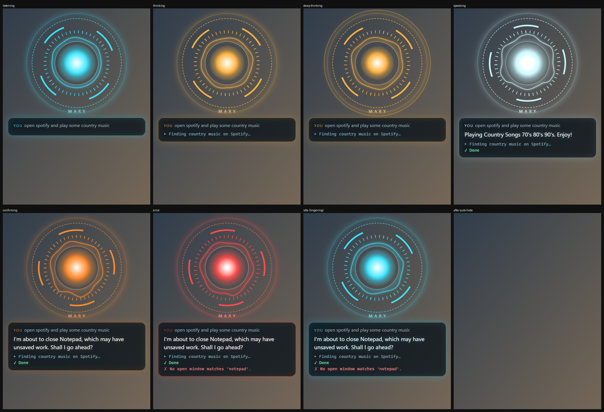

# MARY

A voice assistant for Windows that lives on your PC. Say "Hey Mary" (or press Ctrl+Space), talk the way you
would to a person, and she answers out loud and does it: opens apps and files, types, clicks buttons in any
app, plays music, sets timers, reads your screen, checks the weather and your WhatsApp. Her brain is a local
language model, so she works on an ordinary laptop: **no GPU, no cloud, nothing leaves your PC** unless you
choose to.



## Why "MARY"

MARY is named in memory of my mother. I wanted an assistant that feels like someone who cares: warm, calm,
patient, and on your side. Her character is meant to be yours to shape, from the way she talks to the
voice she speaks in.

## What she can do

- **Talk like a person.** Whole sentences go to her brain, and she answers in her own words. Small talk gets
  small talk, an unclear request gets a short question, and after an action she tells you how it went.
- **Use your PC:**
  - open and close apps; arrange windows
  - volume, brightness and media; lock the PC
  - find, open, move or recycle files
  - type, and press keys
  - click, type and scroll in any app or web page
  - screenshots, notes and timers
  - PowerShell (always shows the command and asks first)
  - Spotify, WhatsApp, the weather, the web
- **Read your screen** and answer questions about it.
- **Remember** what you ask her to ("remember that I prefer Edge"), and your name.
- **Stay safe.** Every action needs words of its kind in what you said, so a misheard sentence can't close
  your work. Risky steps ask first. Files go to the Recycle Bin, never straight to deletion.
- **Hear you well.** She records with browser-style noise suppression, gives you time to pause and think,
  and offers optional live cloud transcription.
- **Speak naturally.** She starts speaking while she's still thinking, and reads numbers, dates and file
  names the way a person would.
- **Wake word trained on your voice,** double-checked so the TV doesn't wake her.

## Quick start

Windows 10/11, Python 3.12, about 6 GB of free RAM. Then:

1. Double-click `setup.bat`. It installs everything: Python packages, the voice models (~1 GB), Ollama, and
   the language model (~2 GB).
2. Start her from PowerShell (or double-click `run.bat`):
   ```powershell
   .\run.bat
   ```
3. Press **Ctrl+Space**, wait for the chime, and speak. Type `/quit` in her window to stop her.

To start MARY whenever you sign in:
```powershell
.venv\Scripts\python.exe -m mary.autostart enable
```

## Make her yours

**The settings page** is the easy way: right-click the tray icon › **Settings…** (or double-click
`settings.bat`). In your browser, on this PC only, you can:
- create your own assistant (a persona): their name, personality, how they talk and write, and their stories
- pick a voice (female or male, on your PC or from ElevenLabs) and hear it
- choose a ready-made wake word, or record and train your own phrase right there
- tell it your name, and choose the model, the microphone and the skills

It edits the same files you could edit by hand, keeping their comments.

By hand: your settings go in `user/config.yaml`, which is created for you and stays private. It's merged over
`config.yaml`, where every option is explained, so you only list what you change.

- **Her character:** a persona pack says who she is, how she talks and writes, her voice, her wake phrase and the
  stories she knows. Make your own with `python -m mary.persona new <name>`, or bring one in from a WhatsApp chat
  or a Character Card. See [personas](docs/personas.md).
- **Her voice:** `python -m mary.voices` plays the built-in voices; set one in her persona.
- **Your wake word:** any phrase, recorded and trained on your PC from the settings page (about 5 minutes of
  recording, then 10–20 of training). See [personas](docs/personas.md#the-wake-phrase).
- **A bigger brain:** `llm.model: qwen3:4b-q4_K_M` follows instructions better, but is about 3 times slower
  on a CPU. `llm.think_by_default: true` makes her think before every answer: wiser, slower.
- **Optional cloud hearing and voice:** with an [ElevenLabs](https://elevenlabs.io) account, she can hear you
  live and almost instantly (`stt.provider: elevenlabs`) and speak in any ElevenLabs voice, including one you
  made (`tts.provider: elevenlabs`). Run `npx -y @elevenlabs/cli@latest onboard init` in MARY's folder to
  connect your account. See [privacy](docs/privacy.md) for what that sends.

## Documentation

- [The full guide](docs/guide.md): everything she does, settings, troubleshooting, measurements
- [How she's built](docs/architecture.md): the core, the bricks, the prompt layout, the two brain modes
- [Personas](docs/personas.md): who she is, in one folder you can write, keep private or share
- [Writing a skill](docs/skills.md): give her a new ability in one file
- [Privacy](docs/privacy.md): what stays on your PC, what the optional services send
- [Contributing](CONTRIBUTING.md)

## Privacy

Everything runs locally by default: the brain (Ollama), hearing (Whisper), her voice (Kokoro), the wake word,
her memory and the logs. Cloud services are opt-in. Your own folder (`user/`), recordings, models, logs and
keys are never part of the repository, and `python -m mary.release_check` makes sure of it.

## License

[MIT](LICENSE)
