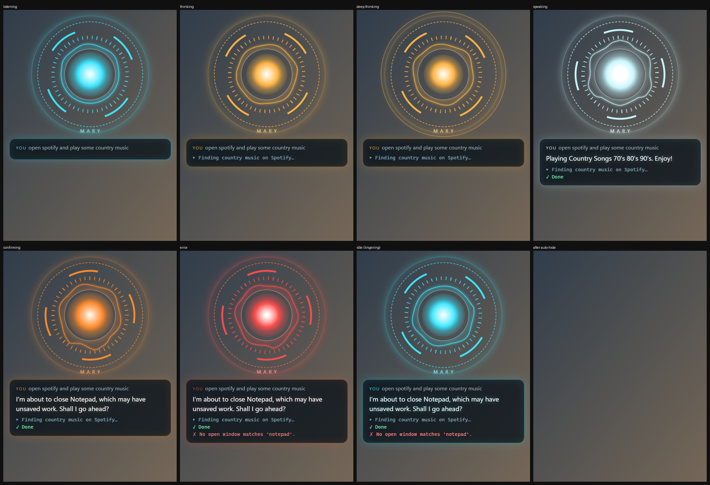

# MARY: the full guide

Everything MARY does, how to use it, and what was measured along the way (on the author's laptop: Ryzen 5 PRO
4650U, 16 GB, no GPU). For a short introduction see the [README](../README.md); for how she's built, see
[architecture.md](architecture.md).

## How MARY speaks
- **She starts talking sooner.** She no longer waits for the whole first sentence: the first phrase up to
  a comma (at least 5 words) is spoken while the rest is still being written. Measured: an answer opening
  "Yes, you should take an umbrella, because…" makes its first sound after 1.6 s instead of 4.0 s.
- **She says everything.** You may not be looking at the screen, so nothing is cut off. Instead she's asked
  to keep replies short but never leave out what matters (numbers, names, times, warnings, what went wrong).
  To stop her mid-answer, press the hotkey.
- **Nothing is read out raw.** Each rule fixes something the voice got wrong when checked by its
  phonemes: "$1,000,000" → "1,000,000 dollars" (it said "dollar one million"), "28°C" → "28 degrees"
  ("degrees see"), "2026-10-26" → "26 October 2026" (read with "dash"), "19:04" → "7 oh four PM",
  "summer-promo-30s.mp4" → "summer promo 30 second video", "e.g." / "vs" / "1/3" / "4–7 s" /
  "2.2GB" / "1990s" → "for example" / "versus" / "1 of 3" / "4 to 7 seconds" / "2 point 2 gigabytes" /
  "nineteen nineties". Markdown, bullet points, emoji, links and folder paths are cleaned up too.
- **The HUD stays up until she's finished talking.** It used to fade 6 s after she finished *thinking*,
  sometimes in the middle of a long answer.

## Running in the background (Phase 5)
- **Tray icon.** In voice mode MARY puts an arc-reactor icon in the notification area by the clock. Windows 11
  may tuck it under the ^ arrow; drag it onto the taskbar to keep it in view. **Left-click** it to talk.
  **Right-click** for: what MARY remembers, your settings (`user/config.yaml`), the log, *Start MARY when I sign in*,
  and *Quit MARY*.
- **Start at sign-in:** tick it in the tray menu, or run `python -m mary.autostart enable` (`disable`,
  `status`). It adds a shortcut to your Startup folder that runs `pythonw -m mary --background`: no console
  window, just the tray icon and a "MARY is ready" notice. You can also see it in Task Manager › Startup apps.
- **Only one MARY at a time.** Starting a second copy just says she's already running (two copies used to
  fight over the microphone and the hotkey).
- **Quitting frees the model's RAM** (~2.2 GB), so the next start loads it again (~40 s; MARY greets you
  once it's ready). Set `llm.unload_on_quit: false` to keep it loaded for quick restarts.

## Acting on the screen (any app or web page)
Say it the way you'd tell a person:
- "**click** subscribe", "press the play button", "click on the Downloads folder", "pick the one where it
  says Eat Everything In A Grocery Store"
- "**play the first video**", "open the second result" (right after MARY opened a web page)
- "**type** MrBeast **into the search box and search**"
- "**scroll** down", "scroll up a bit", "go to the top"
- "**search YouTube for** MrBeast", "find cooking videos on YouTube" (YouTube's own search, so the results
  are videos you can click)

How it works: Windows UI Automation describes every app's buttons, links, tabs, menus and boxes, the same
information screen readers use. One query lists a window's visible ones in 70–450 ms (measured in Edge,
File Explorer and VLC). MARY matches what you said against their names, then uses the control's own
action (no mouse movement), or a real click in its middle with the pointer put back afterwards.
- Hidden controls (YouTube's player buttons while a video plays) still work through their own action.
- Apps that describe nothing, like Spotify, games and some canvas apps, fall back to reading the window's
  text.

Safety:
- Clicking anything labelled like *buy, pay, order, delete, remove, send, submit, post, confirm, accept,
  sign out, unsubscribe…* asks "Shall I go ahead?" first.
- MARY never types into password, PIN or card fields.
- She only acts on the window in front, or one you name.
- **MARY never opens an address she can't point to.** The model can't see the address behind a search
  result, and it once made one up ("This video isn't available"). The web tool now refuses any deep link
  that wasn't in your words or on screen, and MARY clicks the result by its title instead.

## Conversation and honesty
- **She starts when she's fully ready.** Voice mode loads the language model first (~1 minute, up to ~2 after
  a restart), then greets you by name ("Good morning, Sam. I'm ready when you are."). The name comes
  from `name` in `user/profile.yaml`.
- **Weather:** "what's the weather", "is it raining", "how hot is it in Paris". MARY opens a one-line
  weather page (wttr.in) in your browser and reads it off the screen: about 1.5–3 s, in one reused tab.
  She only reports a reading once the address bar shows the page she asked for, and drops misreads.
  Forecasts ("tomorrow") are opened for you to see, because only the current weather can be read reliably.
  `weather.place` in `config.yaml` sets the place (empty = the site guesses from your connection).
- **No invented facts.** Tools say exactly what they did ("I've opened a search for … in your browser",
  not "here's what I found"). When you ask "what did you find?" right after she opened a page, MARY reads
  the screen *before* the model answers, so the answer comes from the page. (A 4B model told to "read
  first" answered without looking, and once invented the weather.)
- **No chatbot filler.** "Anything else?", "Let me know if…", "How can I assist you today?" are removed
  before they're spoken. A reply that was only filler means she didn't understand you, so she asks you
  to say it again.
- **Short replies are instant.** "No", "that's all", "thanks", "okay" and "bye" are answered without the
  model ("Okay." / "You're welcome." / "Bye, Sam.") and end the follow-up listening. "Yes" after
  MARY offered something ("Shall I search for it?") carries the offer out; a bare "yes" when she asked
  nothing just ends the conversation.
- **Fewer misleading guesses.** The router only passes the model a weak guess (similarity 0.65–0.72) when
  that guess's details fit the words: "Yes." no longer arrives with "maybe media". (`router.hint_sure_score`)

## Memory: what MARY knows about you (Phase 5)
Say:
- "**Remember** that I prefer Microsoft Edge" / "keep in mind that my favourite singer is Don Williams"
- "**Forget** that I prefer Edge"
- "**Call me** Sam" / "my name is Sam"
- "What do you remember about me?"

The facts go into `user/profile.yaml`, in your own words. You can edit it by hand too (MARY reads
it when she starts). It never leaves this PC. "Remember to call Mum at five" is a reminder rather than a
fact, so it goes to the model. "Forget it" means "never mind" and never deletes a memory.

Speed: remembering or forgetting is instant (the router handles it). MARY sends the profile to the model as
a short note right after its cached instructions. A change therefore costs one short re-read: the next
question that needs the model took 14–17 s. (Inside the system prompt it took 65–97 s, because Ollama
re-reads the whole tool list after any change there.)

## When something goes wrong (Phase 5)
| Problem | What MARY does |
|---|---|
| Ollama isn't running | Starts `ollama serve` herself. |
| Ollama is missing, won't start, or the model isn't downloaded | Starts anyway in **router-only mode**: apps, volume, music, time, timers, messages… still work. Questions that need the model get "I can't reach my language model right now…". She retries in the background (15 s, then up to every 2 min) and says when it's back. |
| Ollama stops mid-conversation | Restarts it and retries that step once. Tool steps already done aren't repeated. |
| No microphone, or it's unplugged mid-request | Says so once ("I can't hear anything from the microphone…") instead of hanging. She re-scans for a mic on the next Ctrl+Space (or every 5 s with the wake word) and says when it works again. Typing still works. |
| Speakers or headphones unplugged | Notices within 1.5 s instead of waiting up to a minute. Replies stay on screen as text, and the sound reopens on the next reply. |
| Voice models missing | Tells you to run `python -m mary.audio.download` (or use text mode). |
| Anything else | Logged in full to `logs\mary.log`. In background mode, problems also show as tray notices. |

## Voice (Phase 4)
One-time: download the voice models (Kokoro voice, Whisper, Silero VAD, openWakeWord; about 1 GB):
```bash
.venv\Scripts\python.exe -m mary.audio.download
```
Then start MARY:
```bash
run.bat
```
Press **Ctrl+Space** anywhere, hear the chime, speak. MARY transcribes, acts, and replies out loud,
starting with the first sentence while the rest is still being written.

- **Take your time.** A short command ends after a 1.5 s pause. The longer you talk, the longer you may pause
  to think, up to 5 s, so you don't have to rush long requests.
- **No wait for the long pause.** Whisper starts on what you've said 0.5 s into a pause. If you carry on
  talking, that run is thrown away; if not, the transcript is ready when the pause ends. On two real
  recordings that cut the wait after the pause from 4.7–10.5 s to 0–1.1 s, with word-for-word the same
  transcript.
- **Hold Ctrl+Space** to talk for as long as you like (it records until you let go), or **tap it again** to
  say "I'm done" right away.
- **Follow-ups without the hotkey:** after answering, MARY keeps listening for 8 s ("…and how's my battery?").
- **Saying "Hey Mary" first is fine.** MARY ignores it, and if that's all you said, she keeps listening.
- **Dictation:** "open Notepad and write the following text: …", or "type …". If you only say "write the
  following text", she asks "What should I type?" and types your next sentence exactly as you say it.
  Typing into a window that has only just opened waits until it's really ready.
- Press Ctrl+Space while she talks to interrupt her. You can also type a request in the terminal; `/quit` exits.
- All of these timings are under `vad` in `config.yaml`.

**Choose her voice:**
```bash
.venv\Scripts\python.exe -m mary.voices
```
This plays each female voice, best-rated first: af_heart (warm, the default), af_bella, af_nicole, bf_emma
(British, calm)… Then `python -m mary.voices --set bf_emma` makes one hers. `--blend af_heart:0.6,bf_emma:0.4`
tries a mix of two voices.

**Spoken confirmations:** for risky actions she asks "Shall I go ahead?" and listens. "Yes", "go ahead",
"sure", "okay" mean yes. Silence, or anything unclear, means no.

**Measured on the author's laptop** (synthetic speech through the real pipeline):
| Stage | Time |
|---|---|
| Speech to text, small.en | ~2.7 s per request plugged in, ~4.5 s on battery (Whisper always encodes a 30 s window) |
| Speech to text, base.en | ~1.0 s, as accurate on clear speech; set `stt.model: base.en` to try it |
| Router + tool | 10–300 ms for common commands |
| First spoken word | ~0.7 s after the reply is ready (Kokoro synthesises 2× faster than real time) |
| Wake-word listening | ~0.3% of the CPU |
| Waiting for Ctrl+Space in the background | ~0.03% of the CPU |

Short commands on battery ("what time is it", "turn the volume down a bit", "open Notepad"): the first
spoken word is ready 4.0–4.8 s after the 1.5 s pause, against 5.6–5.9 s before Whisper started early.
Plugged in, it's faster. Long requests barely wait at all (see above). Requests that need the LLM add
its time on top.

**Check how MARY hears you:**
```bash
.venv\Scripts\python.exe -m mary.audio.check --mic
```
Speak for 6 seconds, or pass a recording instead (`… check "Recording.m4a"`). It prints:
- your loudness, any clipping, and how far your speech is above the background;
- where it detects speech;
- what Whisper hears raw, and what it hears as MARY hears it.

It saves both versions in `data\audio_check` so you can listen. On a test recording in a noisy room, the background was
−24 dBFS (loud; a quiet room is about −50), with speech only 12 dB above it. MARY's noise filter at
strength 2.5 (`stt.denoise_strength`) was the only setting that got every word. RNNoise, a neural
denoiser, was also tried and made recognition worse, so it isn't used.

**If MARY mishears you:**
- Set your microphone level to about **70%** (Settings › System › Sound › Input › Volume). At 100% many laptop
  mics clip (distort), and MARY says so in the terminal when it happens.
- Speak from about an arm's length, with as little background noise (fan, TV) as you can.
- Run only **one** MARY at a time (`run.bat`). Two copies fight over the microphone and the hotkey.
- If Whisper is unsure, MARY asks you to say it again instead of guessing. Text that looks like a
  YouTube subtitle ("like and subscribe", "thanks for watching") is thrown away. Whisper invents those for
  unclear audio, typically the tail of MARY's own voice; she now waits for the speakers to really go quiet
  before listening again.

Notes:
- Recognition uses beam search, temperature 0 (no "creative" re-decoding of unclear audio: that took 8–10 s
  and produced the invented sentences), a steady-noise filter, and a short context prompt that favours
  MARY's words ("Notepad", not "notes part"). App names also match by sound when speech recognition
  splits them ("spot if I" → Spotify).
- Without a wake word, the microphone is only on while MARY listens (Windows' mic icon shows it).
- The Kokoro **full-precision** model is used: on this CPU the int8 file was 6× *slower*.
- Whisper "hears" words in silence, so MARY ignores those ("you", "thank you"), anything under
  ~0.25 s of speech, and segments Whisper itself marks as probably silent.

## Wake word: "Hey Mary" or "Hey Mom"
Say either one (or "Hey Mum") instead of pressing Ctrl+Space. Each phrase is its own small model, and
they run side by side. One model for both phrases woke 48.6 times an hour on other audio, against 1.4 for
"Hey Mary" alone: the short, common "Hey Mom" blurred what it listened for. They're trained on this PC,
without PyTorch, from openWakeWord's feature models, 11 hours of real-world negative audio, Kokoro's
voices and, most importantly, your voice:
```bash
.venv\Scripts\python.exe -m mary.wakeword_training.record
```
```bash
.venv\Scripts\python.exe -m mary.wakeword_training.train --enable
```
```bash
.venv\Scripts\python.exe -m mary.wakeword_training.train --phrase mom --enable
```
1. **record** (~6–8 min): 40 × "Hey Mary" and 22 × "Hey Mom" in different ways (quiet, loud, quick, across
   the room), 18 things that must *not* wake her ("Mary", "Mum", "I'll call my mum later", "Hey Tom"…),
   25 s of reading aloud, and 20 s of your room's normal sound. Start speaking right after each beep: a
   take without the words in it, or still going when the 3 s ran out, is asked for again.
2. **train --enable**, once per phrase (~15–20 min each): it cuts each take down to the words (Silero VAD),
   skips takes with no speech or cut off, then prints how many of your held-out takes it caught, false
   triggers per hour on other audio, and which sound-alikes still fire. A model that catches at least 80% of
   your takes and wakes less than once an hour on other audio is marked as passed and switches the wake word
   on; MARY loads each phrase only once it has passed. A model that fails is saved as `….failed.onnx` and
   never replaces one that passed. Then restart MARY.
3. Optional: `python -m mary.wakeword_training.test_model --model data\models\wakeword\hey_mom.onnx` shows
   a live score while you talk or watch TV. If it misses you, `record --more` adds another round, then train
   again.

**The double-check** (`wakeword.verify: base.en`): each detection is confirmed by Whisper base.en on the
last 2.5 s before MARY chimes (~0.9 s, at most ~2 s). The home-made models hear you well but are too eager on
other audio ("Hey Mom" fires ~17 times an hour on the held-out stream); with the check, a model may fire up
to 30 times an hour and still pass, since each false wake-up is dropped quietly. Measured on the author's
recordings: 21 of 22 "Hey Mom" takes woke MARY; none of the 40 "Hey Mary" takes, 18 sound-alikes, your
reading aloud or your room sound did. A bare "Mom" counts; "I'll call my mum
later" doesn't. Turning the check off also unloads any phrase that only passed thanks to it.

Why the trimming matters: a laptop mic's hiss sits only ~30 dB under your voice. The first version trimmed
relative to the loudest moment, so it kept every take whole, ~1.2 s of room noise after "Hey Mom" included;
the model learned the noise as the wake word and woke 70–104 times an hour.

A detection only counts if there was speech in that moment (Silero VAD), so music and noise can't wake her.
With the wake word on, the microphone stays open (Windows shows its mic icon) and listening costs about
0.3% of the CPU. "Mum's birthday is on Friday" isn't taken as the wake word: only "Hey Mom"/"Hey Mum" is.

## The HUD (Phase 3)
```bash
run.bat --text --hud
```
An arc-reactor overlay appears in the bottom-right corner whenever MARY works and fades out 6 s after she
finishes. **Ctrl+Space** (anywhere, any app) summons or dismisses it and brings MARY's terminal forward so
you can type. (Phase 4 will use the same key to start listening.)



| State | Look |
|---|---|
| Listening / idle | cyan, slow rotation, live waveform |
| Thinking | amber, faster rotation |
| Deep thinking | amber with an extra dotted outer ring |
| Speaking | white/cyan pulse, reply typed out |
| Confirming | orange, shows the "Shall I go ahead?" question |
| Error | red flash |

- What you typed, MARY's reply (typed out) and tool lines (`▸ Launching Spotify…`, `✓ Done`) show in the panel.
- The HUD is **click-through and never takes focus**, so typing, hotkeys and MARY's own clicks (WhatsApp's
  filter, Spotify's play button) always reach the window underneath. It hides itself for screenshots.
- When hidden it doesn't render at all: **0% CPU**. While visible it uses about 5% of the CPU.
  RAM: about 0.25 GB more than text mode.
- Settings: `hud` in `config.yaml` (`position: bottom-right | center`, size, `hide_after_s`) and
  `hotkey.combo`. While MARY runs, other apps don't receive Ctrl+Space (e.g. VS Code's suggestions
  shortcut). Change the combo there if that bothers you. Ctrl+C in the terminal quits.
- Built with PySide6 + QtWebEngine. pywebview was tested first, but on Windows its window can't be
  transparent, so the HUD would be an opaque box.

## The semantic router (Phase 2)
Common commands skip the LLM. The router matches what you say by *meaning*, so paraphrases work
("get notepad going", "crank it up", "has anyone messaged me"), and runs the tool in milliseconds:

| Request | Through the LLM | Through the router |
|---|---|---|
| open spotify / volume / pause / time / timer | 10–15 s | 10–80 ms |
| how's my battery | ~12 s | ~0.3 s |
| find the PDF I downloaded this week | 20–50 s | ~0.1 s |
| play Don Williams | ~15 s | ~4–6 s (Spotify's own search) |
| open my browser + WhatsApp Web + check messages | ~40 s | ~4.5 s |

How it decides (all thresholds in `config.yaml` → `router`):
1. Compound requests are split into parts ("… and …", "… then …"). Each part is routed on its own.
2. **Guards** send a part straight to the LLM: negations ("don't open spotify"), reasoning ("why…",
   "how do I…"), references to earlier conversation ("do that again", "the other one"), leftover "then".
3. The part is embedded (fastembed, `bge-small-en-v1.5`, ~10 ms) and compared with every example in
   `intents.yaml` (20 intents). Best score ≥ **0.82** with a lead ≥ **0.05** over other intents, and the
   slots filled (an app that exists, a volume change it understands, a duration…) → run directly.
   Commands defined by their first words ("remember …", "forget …", "call me …") skip the score test
   via `lead`: the free text after those words would otherwise decide the match.
4. A score of 0.65–0.82 → the LLM, told the router's guess as a "maybe". Below 0.65 → the LLM plain.
5. Every decision is logged to `logs\routing.jsonl` with scores, so misroutes can be reviewed.

**Tune it with your own phrasings:** add them to `tests\router_cases.yaml` (with the intent you expect, or
`llm`), then run:
```bash
.venv\Scripts\python.exe -m mary.calibrate
```
It prints each request's score, margin, guards and route, the count of **wrong directs** (the router would
have run the wrong action; keep this at 0), and a threshold sweep. In text mode, `/route <request>` shows
the decision for one request without running anything. To teach it a phrasing, add an example to that
intent in `intents.yaml`. Embeddings are re-computed automatically when the file changes.

## What MARY can do so far
- Apps and windows: open/close apps (Store apps too), minimize/maximize/snap/switch windows.
  "Open my browser" opens your default browser. "Open WhatsApp" opens WhatsApp Web, since the app isn't installed.
- System: volume, mute, brightness, lock, battery/CPU/RAM/disk status, timers, screenshots, notes.
- Files: find by name/type/date (Windows Search index), then open, move, or send to the Recycle Bin.
  Ask however you like ("can you give me a list of images in my download folder?", "check if I have any
  new files downloaded today", "what's in my downloads"). Only words that could be part of a file name
  narrow the search ("called budget" searches for that name exactly). MARY names the newest three files she
  finds. Then "open it", "open the second one" or "play the video" open a result straight away, without
  the LLM, for 15 minutes after a search. "Open my downloads folder" opens it in File Explorer. Whole
  folders are never moved or recycled.
- Typing and hotkeys into the focused window, PowerShell (always asks first), and power actions (always ask).
- **Skills** (fixed recipes, so the small model only has to pick one):
  - `play_music`: searches Spotify and plays the best-matching result ("play Don Williams", "play some
    country music"). It checks that the track actually changed, and falls back to YouTube if Spotify can't.
  - `check_messages`: reads WhatsApp Web's chat list and says how many chats are unread and from whom.
    It uses WhatsApp's own "Unread" filter for a moment, then switches back to "All". It never opens
    a chat, so nothing is marked as read. Message text is read only when you ask ("what did Mum say?").
    Chat names are kept out of the log file.
  - `read_screen`: the text of a window (UI Automation, or Windows' built-in OCR for web pages), so you can
    ask about what's on screen.
- Compound requests ("open my browser and open WhatsApp and see if I have messages") are split into parts
  and done one by one, because a 4B model tends to stop after the first step.

## Setup (one time)

**The easy way:** double-click `setup.bat`. It creates the Python environment, installs the packages,
downloads the voice models, installs Ollama (winget) and pulls the model. It's safe to run again, since
finished steps are skipped. Everything below is what it does, step by step, if you'd rather do it by hand.

1. **Install Ollama** (the local LLM server):
   ```bash
   winget install --id Ollama.Ollama -e
   ```
2. **Download the model** (1.9 GB):
   ```bash
   ollama pull qwen3.5:2b-q4_K_M
   ```
   Chosen with MARY's own benchmark (below) over the earlier `qwen3:4b-q4_K_M`, `qwen3:1.7b` and
   `bonsai-2`. It supports tools and switching thinking on/off per request.
3. **Optional, recommended: lower Ollama's RAM use.** These settings apply when Ollama's own tray app
   starts the server. MARY applies them automatically when it has to start the server itself.
   ```bash
   setx OLLAMA_NUM_PARALLEL 1
   ```
   ```bash
   setx OLLAMA_FLASH_ATTENTION 1
   ```
   ```bash
   setx OLLAMA_KV_CACHE_TYPE f16
   ```
   Then quit Ollama from the tray and start it again. (Measured on the author's laptop: a `q8_0` KV cache saves
   ~0.3 GB but makes prompt processing ~1.8× slower on CPU, so `f16` it is. The Radeon iGPU via Vulkan
   was no faster than the CPU.)
4. **Create the Python environment** (Python 3.12) in this folder:
   ```bash
   py -3.12 -m venv .venv
   ```
   ```bash
   .venv\Scripts\python.exe -m pip install -r requirements.txt
   ```
5. **Voice models** (`python -m mary.audio.download`), as under *Voice* above.

## Run

```bash
run.bat --text
```
Add `--debug` to print per-stage latency after each request.

If Ollama isn't running, MARY starts `ollama serve` in the background. A cold start (after a reboot, or after
quitting voice mode, which unloads the model) takes ~35–40 s while the model loads and reads its ~3.5k-token
tool prompt. While the model stays loaded, later starts take a few seconds.

**Speed on this CPU** (plugged in): routed commands answer in milliseconds (see the table above). Requests that
need the model take ~2–7 s, and a "think carefully" answer ~25–55 s. MARY pre-loads the conversation into
Ollama's cache while you're idle, so the next request doesn't re-read what the router handled.

## Choosing the language model
```bash
.venv\Scripts\python.exe -m mary.llm.bench qwen3.5:2b-q4_K_M qwen3:4b-q4_K_M
```
Each model gets MARY's real prompt and tools, then 18 tasks: picking the right tool with the right details,
sums and reasoning, and two traps that once made a model make things up. Only its first decision is scored,
and **no tool is ever run**. Measured on the author's laptop (plugged in):

| Model | Tasks right | Generating | Follow-up request | Cold start | RAM |
|---|---|---|---|---|---|
| **qwen3.5:2b-q4_K_M** (now) | 14/18 | **10.5 tokens/s** | **4–7 s** | **37 s** | **2.2 GB** |
| qwen3:4b-q4_K_M (before) | 15/18 | 3.6 tokens/s | 6–14 s | 85 s | 3.6 GB |
| qwen3:1.7b | 9/18 (wrote tool calls as plain text) | 8.8 tokens/s | | 36 s | 2.1 GB |
| bonsai-2:4b | cancelled: far slower than the others on this CPU | | | | |

The 2B's misses are cases MARY's router and code checks handle before the model is asked. Neither model
can be trusted with mental arithmetic: repeated sums came out right 10/12 times for qwen3.5:2b at the
lower temperature MARY uses, and 0/12 for the old 4B ("575" for 15 × 23, every time). Smaller models
also act more randomly on misheard sentences, which is why **every action needs words of its kind** in
what you said (see Safety).

In the prompt, try:
- `open spotify`
- `turn the volume down a bit`
- `find the PDF I downloaded this week`, then `open the first one`
- `set a timer for a minute and a half`
- `snap notepad to the left`
- `how's my battery`
- `think carefully: what's using my RAM and what should I close?` (deep thinking on)

Text-mode commands: `/stats` (RAM), `/think <request>`, `/apps <name>` (test app matching), `/reset`, `/quit`.

## Safety

- Opening and switching apps, volume, media, lookups, screenshots and notes run immediately.
- Closing apps that may hold unsaved work, moving or recycling files, PowerShell, power actions,
  risky hotkeys (Alt+F4…) and typing more than 200 characters ask **"Shall I go ahead?"** first.
- Files are never deleted permanently; they go to the Recycle Bin.
- **Intent grounding:** every action needs words of its kind in what you said. Volume needs something
  about sound, a timer needs a timer or a duration, your name needs "call me" or "my name", and so on.
  Closing apps, force-quitting, power actions and moving/deleting files need those words too. Given a
  misheard sentence, the 2B model once tried to set the volume to 100% and re-save your name: both are
  now refused, and MARY asks you to say it again. The model can't decide on its own to close something.
  In testing it once tried to force-quit Edge while asked to check WhatsApp. An unasked-for "force" is
  quietly downgraded to a normal close, which still asks first for browsers and editors.
- PowerShell commands matching the blocklist in `config.yaml` (disk formatting, deletes, registry
  edits, Defender/firewall changes, encoded commands, download-and-run…) are refused even if you say yes.
- **In the new mode** she asks only when there's a real reason, and says it ("Notepad may have unsaved work.
  Close it anyway?"). Otherwise:
  - A shutdown or restart you clearly asked for starts a 10-second countdown: "Shutting down in 10
    seconds. Say stop to cancel." Saying "stop" cancels it. Signing out still asks, because it closes every app.
  - Moving a file you named just happens, and "undo" moves it back for 10 minutes afterwards.
  - Recycling a file you named just happens; it's in the Recycle Bin if you want it back.
  - PowerShell and long typing still always ask, and folders are never moved or recycled.
  - When an action she tried is refused because you didn't ask for it, her reply is still hers: asked "I'm
    not feeling well", the 2B tried to put the PC to sleep (refused), then asked what was bothering you.

## Where things go

| What | Where |
|---|---|
| Screenshots | `Pictures\MARY` |
| Notes | `Documents\MARY Notes` |
| Your settings, profile (what MARY remembers) | `user\` (private, never published) |
| Logs | `logs\mary.log`, `logs\latency.jsonl`, `logs\routing.jsonl` |
| Replay reports | `logs\replay\` |
| Start-at-sign-in shortcut | your Startup folder, `MARY.lnk` (`python -m mary.autostart status`) |
| App index, model caches | `data\` |

## Settings

`config.yaml` holds every setting with its default and an explanation: model, context size, sampling, app
aliases ("vs code" → "Visual Studio Code"), known websites, search engine, folders, safety lists, PowerShell
blocklist. Put your own changes in `user/config.yaml` (created for you, private): it's merged over
`config.yaml`, so you only list what you change.

## Tests

```bash
.venv\Scripts\python.exe -m pytest
```

